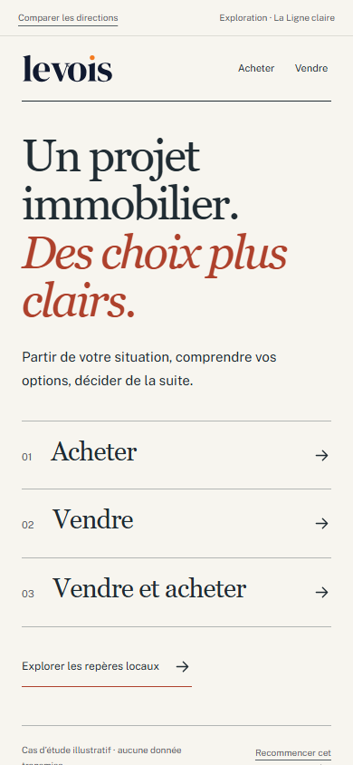
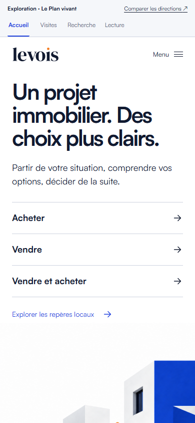
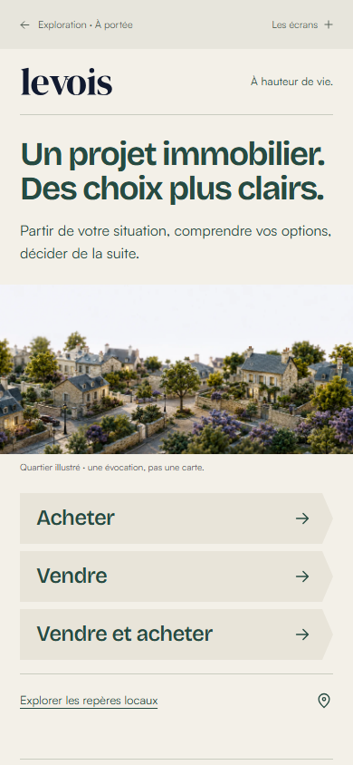

# Trois directions pour LEVOIS

**Dossier d’arbitrage artistique · 10 septembre 2026**

Trois langages visuels sont maintenant consultables sur une même expérience. Les prototypes permettent de choisir une direction ; ils ne constituent pas la migration du site.

**Ma recommandation : Le Plan vivant.** C’est la proposition qui matérialise le plus clairement le rôle propre de LEVOIS : une réponse déplace l’attention, rend une conséquence visible et construit une décision révisable. Ce choix sacrifie une part de la chaleur locale d’À portée et de la simplicité éditoriale de La Ligne claire. Il demande davantage de discipline graphique pour rester juste.

La recommandation n’a déclenché aucune implémentation supplémentaire. **Votre arbitrage reste nécessaire avant la migration.**

[Ouvrir le comparateur interactif](../../explorations/directions-artistiques-20260910/index.html) · [La Ligne claire](../../explorations/directions-artistiques-20260910/ligne-claire/?screen=accueil) · [Le Plan vivant](../../explorations/directions-artistiques-20260910/plan-vivant/?screen=accueil) · [À portée](../../explorations/directions-artistiques-20260910/a-portee/?screen=accueil)

## 1. Ce qui a été fixé, ce qui a été exploré

Le dossier Astra reste le cadre fonctionnel validé : trois parcours, cinq portes d’entrée, plusieurs profondeurs de restitution, continuité, valeur avant collecte et passage progressif vers Mouaad. Cette phase ne relance pas une stratégie générale.

Les trois directions utilisent les **mêmes textes de référence, réponses, faits et conséquences**. Un module local commun gouverne les corrections, la conservation en session et les suites. Le HTML de composition et les styles diffèrent réellement. La différence porte sur la mise en scène : lecture annotée, relation spatiale, feuillet ancré dans les usages.

Les exemples sont fictifs et le disent. Les deux logements A et B ne sont ni disponibles ni recommandés à l’achat. A fait 92 m² avec une pièce indépendante, un séjour compact et un jardin de 35 m². B fait 105 m² avec un bureau dans le séjour, un séjour ouvert et un balcon de 6 m². Leur budget, leur localisation, leurs nuisances et leur disponibilité sont inconnus. Aucun chiffre de marché n’a été inventé pour habiller les preuves.

### Arbitrages intégrés

- **M1 — Relecture.** « Demander à Mouaad de relire » ouvre la prévisualisation d’une relecture humaine écrite, ciblée sur les points ouverts. Elle est distincte de la conservation, de la copie sans appel et de l’échange direct. Aucun délai chiffré n’est promis.
- **M2 — Conservation.** Les réponses anonymes restent dans la session de l’onglet. Le fichier de lecture peut être téléchargé localement. Les actions de copie, de relecture et d’échange n’envoient rien dans ces prototypes et ne demandent aucune coordonnée. Pour la future version, une copie seule ne créera pas de prospect ni de droit de relance ; une demande volontaire pourra créer le seul dossier opérationnel nécessaire. Aucune durée distante n’est fixée ici.
- **Apprentissage par les usages réels.** Le recrutement de cinq habitants n’est plus une condition préalable au lancement. Les premiers utilisateurs des portes réelles permettront d’observer compréhension et progression. La future mesure, sous les conditions de consentement applicables, pourra couvrir première valeur, poursuite, correction, lecture gardée, relecture et question facultative. Aucun outil d’audience ni sollicitation de testeurs n’a été ajouté dans cette phase.

### Protection de l’existant

Le travail réside dans `explorations/directions-artistiques-20260910/`. Le serveur de preuve est indépendant d’Astro et ne possède aucune API d’envoi ou d’écriture. Les actifs existants sont lus depuis `public/` dans ce même worktree. Les sources, routes, données, dépendances déclarées et fonctionnalités de production n’ont pas été modifiées. Aucun déploiement, commit, fusion ou branchement au cockpit.

Référence contrôlée : worktree `levois-experience-cible-20260909`, branche `codex/levois-experience-cible-20260909`, HEAD `52c92ca64ca22606272ae9dd933b5706f4301842`. Le dossier Astra non suivi était déjà présent au début de cette phase.

## 2. Comment regarder les preuves

Le [comparateur](../../explorations/directions-artistiques-20260910/index.html) affiche trois cadres interactifs côte à côte sur un écran assez large. Les commandes communes changent la situation et la largeur demandée, 390 ou 320 px. Sur un écran plus petit, un sélecteur donne accès aux trois directions. La largeur réellement affichée est indiquée. « Ouvrir en plein écran » permet de juger la composition desktop ou d’utiliser le prototype directement sur un téléphone.

1. **Accueil.** Repérer acheter, vendre, vendre et acheter ; distinguer les repères locaux. Le lien vendeur mène au cas de preuve des visites, et la transition à un aperçu court : ce ne sont pas des parcours complets.
2. **Depuis une vidéo.** Choisir « Je n’ai pas de retour précis », puis une autre réponse. La conséquence et la prochaine question changent. La première explication précède la réponse et toute collecte.
3. **Un usage à clarifier.** Passer du calme à l’accueil des proches, puis au dehors. Le fait discriminant change, sans que les usages non sélectionnés soient déclarés abandonnés. « Voir ce que cette réponse change » conduit à une conséquence déjà présente.
4. **Restitution.** Garder la priorité, lire ce qui est compris, solide, conditionnel et ouvert, puis la prochaine décision utile. Corriger et vérifier que la lecture suit. Télécharger la lecture ; examiner ensuite les trois prévisualisations distinctes.

Le cas « calme » sert de point de départ illustratif, pas de préférence déduite d’un visiteur inconnu. « Réinitialiser les trois exemples » remet la comparaison dans cet état commun.

### Les mêmes preuves pour chaque proposition

| Situation | La Ligne claire | Le Plan vivant | À portée |
|---|---|---|---|
| Accueil mobile | [390 px](../../explorations/directions-artistiques-20260910/preuves/ligne-claire-accueil-390.png) | [390 px](../../explorations/directions-artistiques-20260910/preuves/plan-vivant-accueil-390.png) | [390 px](../../explorations/directions-artistiques-20260910/preuves/a-portee-accueil-390.png) |
| Vidéo, réponse et conséquence | [Lecture complète](../../explorations/directions-artistiques-20260910/preuves/ligne-claire-visites-390-complet.png) | [Lecture complète](../../explorations/directions-artistiques-20260910/preuves/plan-vivant-visites-390-complet.png) | [Lecture complète](../../explorations/directions-artistiques-20260910/preuves/a-portee-visites-390-complet.png) |
| Acquéreur, usage et comparaison | [Lecture complète](../../explorations/directions-artistiques-20260910/preuves/ligne-claire-recherche-390-complet.png) | [Lecture complète](../../explorations/directions-artistiques-20260910/preuves/plan-vivant-recherche-390-complet.png) | [Lecture complète](../../explorations/directions-artistiques-20260910/preuves/a-portee-recherche-390-complet.png) |
| Restitution mobile | [Lecture complète](../../explorations/directions-artistiques-20260910/preuves/ligne-claire-lecture-390-complet.png) | [Lecture complète](../../explorations/directions-artistiques-20260910/preuves/plan-vivant-lecture-390-complet.png) | [Lecture complète](../../explorations/directions-artistiques-20260910/preuves/a-portee-lecture-390-complet.png) |
| Acquéreur desktop | [1440 px](../../explorations/directions-artistiques-20260910/preuves/ligne-claire-recherche-1440.png) | [1440 px](../../explorations/directions-artistiques-20260910/preuves/plan-vivant-recherche-1440.png) | [1440 px](../../explorations/directions-artistiques-20260910/preuves/a-portee-recherche-1440.png) |
| Acquéreur étroit | [320 px](../../explorations/directions-artistiques-20260910/preuves/ligne-claire-recherche-320.png) | [320 px](../../explorations/directions-artistiques-20260910/preuves/plan-vivant-recherche-320.png) | [320 px](../../explorations/directions-artistiques-20260910/preuves/a-portee-recherche-320.png) |

Les captures initiales de la vidéo, les restitutions après correction, les accueils desktop, les restitutions desktop et les aperçus local/transition se trouvent également dans `preuves/`. Les images ci-dessous et les cadres du comparateur sont des points de vue sur les mêmes prototypes, pas des variantes supplémentaires.

## 3. La Ligne claire

**Idée directrice : le projet devient une lecture que l’on peut annoter.**

LEVOIS ressemble ici à une publication de conseil que l’on a envie de lire et de garder. Le raisonnement s’organise par titres, marges, filets et annotations. La sophistication vient du rythme, du contraste typographique et de la précision, avec très peu d’effets.

### Le langage

- **Philosophie visuelle.** Une page ouverte, des éléments alignés, une annotation qui éclaire un fait. Les choix sont des lignes de lecture, sans grille de cartes. Le blanc cassé reste très clair, sans texture de vieux papier.
- **Typographie.** Georgia pour les titres, avec l’italique réservé aux inflexions importantes ; Public Sans local pour les réponses, légendes et commandes. Le logo SVG actuel reste reconnaissable. La distinction entre voix éditoriale et action est immédiate.
- **Couleurs.** Papier `#f7f5ef`, encre `#202c33`, vermillon `#ae412c`. Le vermillon désigne la conséquence et la correction ; il n’est pas un code d’alarme. La disparition du cobalt est un choix de ton, pas une nécessité fonctionnelle.
- **Images.** Pas d’image d’ambiance en entrée. Le portrait réel intervient au relais humain. Une future image de terrain devrait apporter une information, une légende et une provenance, plutôt que remplir un espace.
- **Données.** Les mêmes unités et les mêmes faits sont alignés dans deux spécimens. Une ligne soulignée met en regard le critère examiné. Des données de marché pourraient prendre la forme de tableaux ouverts ou de graphiques sobres, toujours avec période, périmètre et effectif.
- **Choix, incertitudes et comparaisons.** Le radio apparent et le filet sélectionné rendent le choix contrôlable. Le texte conditionnel reste écrit en toutes lettres. La glose ne transforme pas une préférence en score ou en certitude.
- **Mouvement.** La signature conduit à la glose ; un bref accent de lecture accompagne le focus. La correction remplace l’annotation et le soulignement. Aucun faux temps de calcul.
- **Mouaad.** Un auteur responsable de la prochaine lecture, identifié par son vrai portrait et son prénom, après la décision utile. Il n’est pas une bulle d’assistance permanente.

### Ce que les écrans démontrent

Sur mobile, le titre d’accueil pose une intention forte puis les trois entrées s’alignent sans détour. La micro-expérience donne une première explication avant ses choix. L’acquéreur voit d’abord la conséquence de son usage, puis les deux spécimens. Sur desktop, la question et les choix occupent une colonne, la comparaison et sa glose une autre. La lecture peut s’allonger sans devenir un tableau de bord.

Le déplacement de la glose avant la comparaison sur mobile est intentionnel : il rapproche la première valeur. Le desktop conserve davantage la logique de lecture en regard. Les textes sont identiques.

### Forces, faiblesses et durée

**Force principale :** la confiance par l’explication. Cette direction sait rendre une limite ou une condition aussi lisible qu’une conclusion. Elle se prête particulièrement bien à des restitutions longues et à des micro-expériences nombreuses, sans demander une nouvelle image pour chacune.

**Faiblesse principale :** une certaine distance. Le lieu et la vie quotidienne ne sont pas immédiatement incarnés. Une personne arrivant d’un contenu social très chaleureux peut ressentir un changement de ton. L’italique doit rester rare pour ne pas gêner une lecture rapide.

**Risque à long terme :** devenir une belle revue générique de conseil. La singularité de LEVOIS dépendrait alors surtout de sa qualité d’analyse, du vocabulaire et des annotations, avec moins de reconnaissance par l’image.

**Écosystème vidéo :** le filet, l’extrait et l’annotation se réemploient facilement dans un titre ou une conséquence issue d’une vidéo. Le raccord serait sobre, plus intellectuel que sensoriel. Un grand volume de micro-expériences reste peu coûteux visuellement.

**Croissance :** très bonne capacité à accueillir plus de sujets, de conditions et de données. Le risque est l’accumulation de prose ; chaque écran doit conserver une décision principale et une conclusion accessible.

**En la choisissant, on gagne** en autorité calme, en lisibilité du raisonnement et en simplicité de maintenance. **On sacrifie** une partie de la présence locale immédiate et du caractère visuel mémorable d’une interface qui montre physiquement les effets d’un choix.

[Essayer La Ligne claire](../../explorations/directions-artistiques-20260910/ligne-claire/?screen=recherche) · [Planche d’intention](../../explorations/directions-artistiques-20260910/concepts/ligne-claire.png) · [Registre de fidélité](../../explorations/directions-artistiques-20260910/ligne-claire/NOTES.md)

## 4. Le Plan vivant

**Idée directrice : chaque réponse déplace le regard sur ce qui compte.**

LEVOIS devient un espace de travail clair où le projet prend progressivement forme. La relation entre choix et conséquence constitue le langage de marque. Le cobalt relie ; l’orange désigne un point d’attention ; le blanc maintient la lisibilité.

### Le langage

- **Philosophie visuelle.** Des champs ouverts, une question forte, une conséquence reliée et des faits comparables. Le contraste d’échelle guide la lecture. Le dispositif reste une expérience de décision, sans écran de contrôle ni métriques décoratives.
- **Typographie.** Satoshi local, avec des titres géométriques plus denses et un poids assumé. Une seule famille simplifie la cohérence entre interface, données et futurs supports vidéo. Le mot-symbole actuel est conservé.
- **Couleurs.** Blanc véritable `#ffffff`, encre `#111a30`, cobalt `#2545df`, orange `#f47b20`. La continuité avec la marque actuelle est forte. Le bleu pâle repère une zone ; il ne certifie ni un bien ni un degré de réussite.
- **Images.** Une architecture imaginée sert de composition d’accueil et porte sa légende. Elle n’est pas une photographie locale. Les plans de comparaison sont des schémas fictifs, non à l’échelle ; les faits essentiels restent en texte. Mouaad conserve son portrait réel au relais.
- **Données.** Quantités, légendes et espaces sont rapprochés. Changer d’usage déplace le critère examiné dans les deux plans. Les chiffres restent stables : la personnalisation change leur lecture, pas les faits. Pour d’autres données, cette logique doit se traduire en repère adapté, sans imposer un plan architectural partout.
- **Choix, incertitudes et comparaisons.** La sélection combine contraste, coche et point, sans dépendre de la couleur seule. La conséquence précède la preuve graphique sur mobile. Une limite textuelle explicite accompagne l’interprétation. Aucun « meilleur bien » ou score de compatibilité n’est produit.
- **Mouvement.** La réponse actualise immédiatement le texte et les zones observées. La signature déplace le focus vers le sens de ce changement. Le mouvement souligne la relation, sans cacher une étape ni retarder la réponse.
- **Mouaad.** Le regard humain arrive après les cinq parties de la restitution et les possibilités de conservation. Son apport porte sur les points que le système ne peut pas vérifier honnêtement à distance.

### Ce que les écrans démontrent

La vidéo relie directement une réponse à sa conséquence avec un trait et un point. L’acquéreur compare un usage plutôt qu’une typologie : les mêmes 92 et 105 m² prennent une signification différente selon le calme, les proches ou le dehors. Sur desktop, les plans disposent d’un espace utile à côté de la question. La restitution conserve une ligne verticale claire, avec son titre en marge, puis les suites dans l’ordre.

La première version plaçait la conséquence trop bas après les plans sur mobile. La preuve finale la place avant les plans. À 390 px, son énoncé complet est visible dans le premier écran de recherche ; les preuves et limites suivent naturellement. L’illustration d’accueil se place après les accès sur mobile.

### Forces, faiblesses et durée

**Force principale :** montrer le travail de clarification. Le système devient identifiable par ce qu’il fait : il déplace l’attention et révèle une différence concrète. Ce langage donne une signature cohérente à la promesse « voir ce que cette réponse change ».

**Faiblesse principale :** la chaleur locale est moins immédiate. L’architecture blanche et bleue peut évoquer un studio d’architecture ou une offre immobilière. La légende évite la confusion factuelle, mais ne supprime pas cette association émotionnelle.

**Risque à long terme :** multiplier les diagrammes ou leur faire dire plus que les données. Un point ne doit pas devenir un score de confiance, une zone bleue une recommandation, ni une belle relation graphique une preuve causale. Les plans petits à 320 px sont un appoint ; le texte reste indispensable.

**Écosystème vidéo :** très bon potentiel. Une question, un choix et le point que ce choix déplace peuvent rester reconnaissables de la vidéo à la micro-expérience. Les futures pages doivent réutiliser cette grammaire ; elles n’ont pas besoin d’une scène 3D ou d’un dessin inédit pour chaque vidéo.

**Croissance :** forte capacité pour les raisonnements, données et arbitrages, à condition d’avoir peu de formes stables : lien, comparaison, intervalle, condition. Les sujets qui n’ont pas de dimension spatiale doivent rester textuels lorsque c’est plus juste.

**En la choisissant, on gagne** une signature de produit, une relation réponse–conséquence immédiatement démontrable et une continuité forte avec le cobalt/Satoshi de LEVOIS. **On sacrifie** de l’émotion locale immédiate et la maintenance minimale de La Ligne claire. La conception des représentations demandera un contrôle éditorial et graphique plus rigoureux.

[Essayer Le Plan vivant](../../explorations/directions-artistiques-20260910/plan-vivant/?screen=recherche) · [Planche d’intention](../../explorations/directions-artistiques-20260910/concepts/plan-vivant.png) · [Registre de fidélité](../../explorations/directions-artistiques-20260910/plan-vivant/NOTES.md)

## 5. À portée

**Idée directrice : les choix immobiliers prennent la mesure de la vie quotidienne.**

LEVOIS se présente comme un lieu accueillant, précis et habité. Le quartier illustré installe une proximité sensible ; les rubans guident les choix ; un feuillet rassemble ce qui devient clair. La personnalité est chaleureuse sans devenir familière ou envahissante.

### Le langage

- **Philosophie visuelle.** Des surfaces calmes, des rubans de choix et un feuillet ouvert. Le langage emprunte au document que l’on garde et aux lieux que l’on habite, sans texture rustique ni codes de luxe.
- **Typographie.** Bricolage Grotesque local pour une voix expressive sans empattements ; Satoshi pour le corps et les commandes. Le logo existant reste le point de reconnaissance. Le contraste vient davantage de la forme des lettres que d’un grand écart entre familles.
- **Couleurs.** Calcaire `#f3f0e8`, pin `#264b42`, terre `#a44029`. Le pin stabilise les choix ; la terre indique le feuillet de conséquence. Ces couleurs font évoluer les codes de marque plutôt que de les recolorer sans projet.
- **Images.** L’illustration actuelle du quartier est réexaminée et conservée pour son potentiel d’évocation. Elle est légendée comme illustration, jamais comme carte ou preuve d’un lieu réel. Le portrait réel de Mouaad vient seulement au passage humain. Aucun faux voisin ni personnage d’assistance.
- **Données.** Une table ouverte aligne les faits. La ligne pertinente change et un trait marque le point à examiner. Les unités restent explicites. Le feuillet ne doit pas imposer trop de marge aux tableaux longs : les données plus denses demanderont des vues dédiées ouvertes.
- **Choix, incertitudes et comparaisons.** Le ruban pin et la coche rendent le choix visible. Le feuillet distingue ce qui est compris, conditionnel et encore ouvert. La chaleur visuelle ne remplace jamais l’énoncé d’une limite.
- **Mouvement.** La conséquence apparaît sans délai ; la signature accompagne le feuillet d’un très léger mouvement d’ouverture. La correction réécrit le même feuillet et déplace la ligne examinée. La version avec mouvement réduit conserve tout le sens.
- **Mouaad.** Une présence personnelle, avec un portrait un peu plus ample, après la lecture et les possibilités de conservation. La relecture écrite est nommée avant l’échange direct ; aucune promesse de disponibilité n’est ajoutée.

### Ce que les écrans démontrent

L’accueil fait coexister la promesse, un imaginaire local et les trois projets. La vidéo transforme un retour imprécis en feuillet utile. Le parcours acquéreur montre la conséquence avant sa table de preuve. La restitution prend la forme d’un document que l’on peut corriger, garder, puis faire relire. Le desktop donne de l’ampleur au quartier et aux tableaux ; le relais humain suit visuellement le document, au lieu de concurrencer sa première lecture.

### Forces, faiblesses et durée

**Force principale :** réunir proximité et clarté. La direction donne immédiatement le sentiment que le sujet concerne la vie de la personne et un environnement habité. Le passage vers Mouaad paraît naturel.

**Faiblesse principale :** la densité. Les bordures du feuillet, ses marges et la table consomment de la largeur. À 320 px, le texte reste lisible mais la comparaison demande plus de lecture qu’un simple repère graphique.

**Risque à long terme :** faire du feuillet et du ruban des motifs automatiques. Ils doivent conserver une fonction précise. Une accumulation de photos d’ambiance pourrait aussi faire glisser le produit vers une agence immobilière traditionnelle.

**Écosystème vidéo :** très bon raccord avec des contenus de terrain, des situations vécues et une parole humaine. Le feuillet de conséquence est réutilisable pour de nombreuses micro-expériences. Il faudra éviter de commander une illustration nouvelle pour chaque sujet.

**Croissance :** bonne cohérence pour les parcours et les documents personnels. Les représentations de données complexes seront moins naturellement servies par le vocabulaire du feuillet que par les champs ouverts du Plan vivant.

**En la choisissant, on gagne** l’émotion locale, une relation humaine chaleureuse et une personnalité accueillante. **On sacrifie** une partie de la compacité des données et de la continuité avec le cobalt actuel. Il faut accepter cette évolution de marque, et ne pas la réduire à un changement de couleurs.

[Essayer À portée](../../explorations/directions-artistiques-20260910/a-portee/?screen=recherche) · [Planche d’intention](../../explorations/directions-artistiques-20260910/concepts/a-portee.png) · [Registre de fidélité](../../explorations/directions-artistiques-20260910/a-portee/NOTES.md)

## 6. Comparaison sur les mêmes critères

Les appréciations ci-dessous sont un jugement de direction artistique étayé par les prototypes. Ce ne sont ni des scores utilisateurs ni des mesures de conversion. Les termes « fort » et « très fort » expriment une comparaison entre ces trois propositions.

| Critère | La Ligne claire | Le Plan vivant | À portée |
|---|---|---|---|
| Première impression | Maîtrise éditoriale, retenue, sérieux | Clarté active, précision, énergie | Proximité, attention, calme |
| Caractère mémorable | Fort par la typographie et la glose | Très fort par le point et la relation visible | Fort par les rubans et le feuillet |
| Confiance | Très forte : les conditions se lisent bien | Forte, si le dessin reste une aide et non une preuve | Très forte par l’accueil et la responsabilité humaine |
| Lisibilité | Très forte ; italique à doser | Très forte ; contraste et Satoshi cohérents | Forte ; petits tableaux à surveiller |
| Qualité mobile | Très forte, peu d’éléments à charger | Très forte après remontée de la conséquence | Très forte pour les choix ; document plus long |
| Compréhension | Très forte pour expliquer et nuancer | Très forte pour montrer une différence concrète | Très forte pour partir de la vie quotidienne |
| Représentation des raisonnements | Très forte en texte et conditions | Très forte en relation réponse–conséquence | Forte via le feuillet structuré |
| Représentation des données | Forte, sobre, extensible | Très forte quand la forme est justifiée | Forte pour les tableaux simples, moins compacte |
| Représentation des arbitrages | Très forte par la mise en regard | Très forte par le déplacement d’attention | Forte par la ligne comparée et le compromis écrit |
| Émotion | Mesurée, surtout intellectuelle | Mesurée, sentiment de contrôle | La plus forte, sensible et accueillante |
| Présence locale | Faible dans l’entrée actuelle | Modérée ; illustration non locale | La plus forte, quoique le quartier reste illustratif |
| Personnalité de marque | Une publication de conseil exigeante | Un outil de clarification reconnaissable | Une marque de proximité habitée |
| Évolutivité | Très forte, particulièrement textuelle | Très forte sous une grammaire graphique limitée | Forte, avec vigilance sur la densité |
| Difficulté technique | La plus faible | Moyenne, la plus élevée des trois | Faible à moyenne |
| Performance probable | La plus favorable : presque aucun raster en entrée | Bonne pour les écrans de travail ; image d’accueil à optimiser | Bonne avec les images existantes adaptées au viewport |
| Maintenabilité | La plus simple | Bonne, avec entretien des schémas et des légendes | Bonne, si le feuillet reste un composant souple |
| Cohérence future avec la vidéo | Très bonne pour la parole analytique | La plus distinctive pour le lien question–effet | Très bonne pour le terrain et les situations vécues |

### Ce que signifie « performance probable »

Les prototypes n’utilisent ni framework client supplémentaire, ni moteur 3D, ni police distante, ni suivi d’audience. La Ligne claire sollicite principalement texte, SVG et polices. À portée réemploie le quartier du dépôt. Le Plan vivant possède un actif architectural PNG d’environ 1,5 Mo : il reste acceptable pour une preuve locale, mais sa déclinaison responsive et son encodage seraient à traiter si cette direction était choisie. Les schémas interactifs sont des SVG légers.

Ce jugement ne remplace pas des mesures réseau mobile réelles, des Core Web Vitals ou un essai sur appareil physique. Aucun score Lighthouse n’est inventé. Le comparateur charge trois expériences pour les examiner ; son poids n’est pas représentatif d’une seule future page publique.

## 7. Pourquoi je recommande Le Plan vivant

Le dossier Astra recommandait initialement une composition éditoriale de la décision. La Ligne claire en donne une preuve solide. Après avoir regardé les trois rendus, **je privilégie Le Plan vivant**, parce que son langage rend plus tangible la transformation promise par LEVOIS.

Le changement d’une réponse ne se limite pas à recevoir une nouvelle phrase. Dans la preuve acquéreur, les faits restent identiques, mais la zone à examiner et l’explication changent ensemble. Dans la vidéo, le choix se prolonge immédiatement en conséquence. Dans la lecture, les points compris et ouverts forment une ligne lisible. Ce sont trois expressions d’une même idée, applicables à d’autres sujets sans dessiner un nouveau décor à chaque fois.

Cette préférence ne vient pas de l’architecture imaginaire d’accueil. Cet actif est même son point le plus discutable : il donne moins de présence locale que le quartier d’À portée. **La valeur distinctive est la relation entre réponse, fait et conséquence.** Elle peut devenir un langage reconnaissable de LEVOIS dans les micro-expériences issues des vidéos, tout en conservant le logo, Satoshi et le cobalt déjà présents.

Le prix de ce choix est clair : plus de contrôle sur la justesse des représentations, une discipline stricte sur le rôle des couleurs, et moins de chaleur immédiate. Si la priorité d’arbitrage est la proximité locale dès la première seconde, **À portée est le choix le plus cohérent**. Si elle est la sobriété éditoriale et le coût d’entretien minimal, **La Ligne claire est le choix le plus sûr**.

Je recommande une direction entière, pas un assemblage automatique des trois. Votre choix pourra retenir l’une d’elles ; une éventuelle retouche de ses actifs ou de son degré d’expression devra ensuite rester cohérente avec son idée directrice.

## 8. Vérifications et limites réelles

### Vérifications effectuées

- **51 combinaisons d’écran et de largeur** : pour chaque direction, accueil, entrée vidéo, vidéo après réponse, acquéreur et lecture à 390, 320 et 1440 px, plus les deux aperçus à 390 px. Les formats mobiles utilisent 844 px de hauteur, les vues desktop 1000 px.
- Aucun débordement horizontal, image manquante, erreur JavaScript, ressource en échec ou requête sortante relevé sur cette matrice.
- Aucun défaut signalé par axe sur les règles WCAG A/AA automatisées utilisées. Les petites cibles de boutons relevées au premier passage ont été agrandies ; le dernier contrôle n’en relève plus sous 40 px. Cela ne constitue pas une certification complète d’accessibilité.
- Les trois réponses vendeur et les trois priorités acquéreur changent réellement la conséquence. Le bouton signature place le focus au bon endroit. La correction conserve la réponse, puis actualise la restitution.
- Le téléchargement contient la lecture attendue. Copie, relecture et échange ouvrent des dialogues distincts, signalent leur caractère local, se ferment avec Échap et rendent le focus à leur déclencheur. Aucun e-mail ni demande à Mouaad n’est envoyé.
- Aucun cookie ni entrée de localStorage n’a été créé pendant ces scénarios. Les seules réponses conservées par le prototype sont anonymes, dans sessionStorage.

La revue visible a utilisé le navigateur intégré IAB. Les captures enregistrées et les répétitions multi-formats ont été réalisées avec Playwright local, afin de produire des fichiers reproductibles ; l’interface IAB utilisée ne propose pas de destination de capture sur disque. Les trois planches et les captures finales ont été inspectées avec `view_image` sur au moins les points suivants : composition, textes et ordre, typographie, palette, images, comparaison, commandes, responsive et relais humain.

### Écarts intentionnels entre planches et prototypes

Les planches ont été produites avec l’outil imagegen intégré, puis enregistrées avec leurs prompts dans `concepts/`. Ce sont des intentions, pas des captures du produit. Le code conserve les textes exacts du cas commun, les limites complètes et le portrait réel. Les approximations de texte, de portrait ou de progression apparues dans les images générées n’ont pas été reprises.

La première valeur a été remontée sur mobile lorsque la composition d’intention la repoussait. Les commandes ont été agrandies pour le toucher. Les plans sont codés comme schémas accessibles, les textes et boutons restent natifs. Le bandeau de preuve est extérieur au produit. Les [registres par direction](../../explorations/directions-artistiques-20260910/ligne-claire/NOTES.md) détaillent les écarts et les corrections, avec ceux du [Plan vivant](../../explorations/directions-artistiques-20260910/plan-vivant/NOTES.md) et d’[À portée](../../explorations/directions-artistiques-20260910/a-portee/NOTES.md).

### Limites de cette phase

Ces preuves ne comprennent pas les trois parcours complets, les vraies restitutions de toutes profondeurs, les cinq portes raccordées au site, le marché local branché, le backend, la copie par e-mail, le dossier de relecture, la prise de rendez-vous, la conservation distante ou le cockpit. Les deux aperçus supplémentaires servent seulement à rendre les accès de l’accueil jugeables.

La vidéo est représentée par son point d’arrivée froid ; aucun lecteur, contenu vidéo ou pipeline n’a été construit. Les autres portes validées restent des contextes d’entrée à respecter lors de la migration : Google pour une question ou un repère, QR avec son intention, recommandation avec une preuve de méthode, continuité après contact avec le contexte déjà compris. Ces contextes ne constituent pas des directions artistiques supplémentaires.

Les vues 320/390 sont des viewports de navigateur, pas des tests physiques sur iPhone ou Android. Aucun habitant n’a été recruté. Aucun délai de première valeur n’est présenté comme une mesure humaine. La robustesse aux futurs textes beaucoup plus longs, les lecteurs d’écran et la performance en réseau contraint resteront à éprouver lors de l’implémentation choisie.

## 9. Ce qui reste à arbitrer — et arrêt

**Un seul arbitrage principal : lequel de ces trois langages doit devenir celui de LEVOIS ?** Les arbitrages M1, M2 et sur l’apprentissage par les premiers utilisateurs sont enregistrés ; ils ne sont pas remis en discussion.

Le degré de présence de l’illustration d’accueil, l’éventuelle place du cobalt selon la direction et la forme des futures données pourront se préciser à l’intérieur du langage retenu. Les modalités professionnelles et juridiques de conservation distante resteront à confirmer avant leur activation, sans inventer de durée maintenant.

Les trois propositions sont consultables, les preuves sont conservées et le dossier comparatif est terminé. **Arrêt de cette phase : aucune migration ne suit cette recommandation sans votre arbitrage explicite.**
